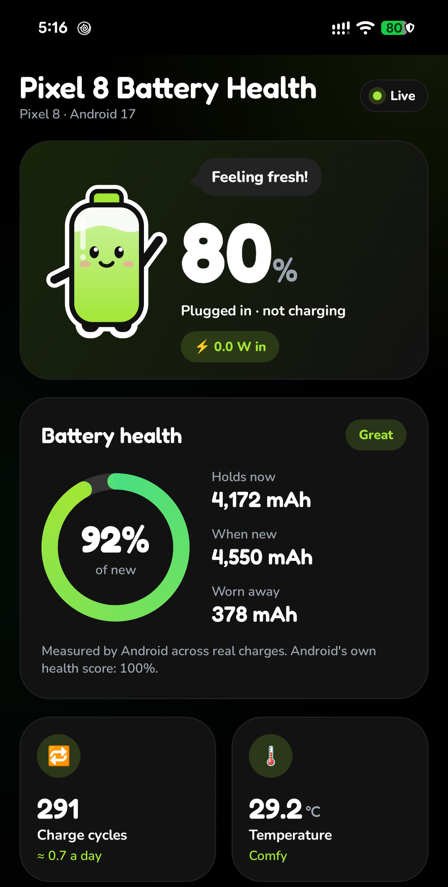

# Pixel 8 Battery Health

[](https://github.com/AhmedVohra/Pixel-8-Battery-Health/releases/latest)
[](https://github.com/AhmedVohra/Pixel-8-Battery-Health/releases)


Free Android app to check your **Pixel 8 battery health**: how much charge the battery holds now compared with when it was new, the **charge cycle count**, temperature and live power use. No root needed.

**[Download the APK](https://github.com/AhmedVohra/Pixel-8-Battery-Health/releases/download/v1.0/Pixel-8-Battery-Health-1.0.apk)** · [Website](https://ahmedvohra.github.io/Pixel-8-Battery-Health/) · [All releases](https://github.com/AhmedVohra/Pixel-8-Battery-Health/releases)



## What it shows

- **Battery health**: capacity now vs. the 4,550 mAh design capacity, as a percentage and in mAh, plus how much has worn away
- **Charge cycle count** and average cycles per day
- **Live power** in watts, with a graph of the last two minutes
- **Temperature, voltage and current** (charge or drain in mA)
- **Battery age**: manufacture date, first-use date and time in use
- **Charging**: status, charger type and time until full

## How to check battery health on a Pixel 8

1. On your phone, download [Pixel-8-Battery-Health-1.0.apk](https://github.com/AhmedVohra/Pixel-8-Battery-Health/releases/download/v1.0/Pixel-8-Battery-Health-1.0.apk) (3.5 MB).
2. Open it and allow your browser or file manager to install apps when Android asks.
3. Open **Pixel 8 Battery Health**. Charge cycles, temperature and live power show right away, and the Battery health card shows an estimate.

Needs Android 8.0 or newer. Built and tested on a Pixel 8 with Android 17. The cycle count needs Android 14 or newer.

## Unlock measured capacity (optional)

Android's measured capacity, its health score and the battery dates sit behind system permissions that only a computer can grant. Turn on USB debugging, connect the phone and run:

```
adb shell pm grant dev.rubiks.batterybuddy android.permission.BATTERY_STATS
adb shell pm grant dev.rubiks.batterybuddy android.permission.DUMP
adb shell pm grant dev.rubiks.batterybuddy android.permission.PACKAGE_USAGE_STATS
```

| Permission | Unlocks |
|---|---|
| `DUMP` and `PACKAGE_USAGE_STATS` | Battery capacity measured by Android across real charges |
| `BATTERY_STATS` | Android's health score, manufacture date and first-use date |

Without them the app estimates health from the current charge.

## FAQ

**Does it need root?** No.

**Does it work on the Pixel 8 Pro, 8a or other phones?** It installs on any phone with Android 8.0 or newer and shows live readings. The design capacity is built in for the Pixel 8 only; other phones have not been tested.

**Is my battery data sent anywhere?** No. Battery readings stay on the phone. The app shows one Google AdMob banner ad. See the [privacy policy](https://ahmedvohra.github.io/Pixel-8-Battery-Health/privacy.html).

**Is the source code available?** No, only the APK is published.

## Verify the download

- APK SHA-256: `3486d864fba5cd3dd3ce7400db034859a62fe56e647bf50e8b7acef0b2088a70`
- Signing certificate SHA-256: `f02d11df8b793a903a44286f3a3ede52c155cd09756d3c8578a22aac2df846ee`

---

Not affiliated with Google. Pixel is a trademark of Google LLC.
