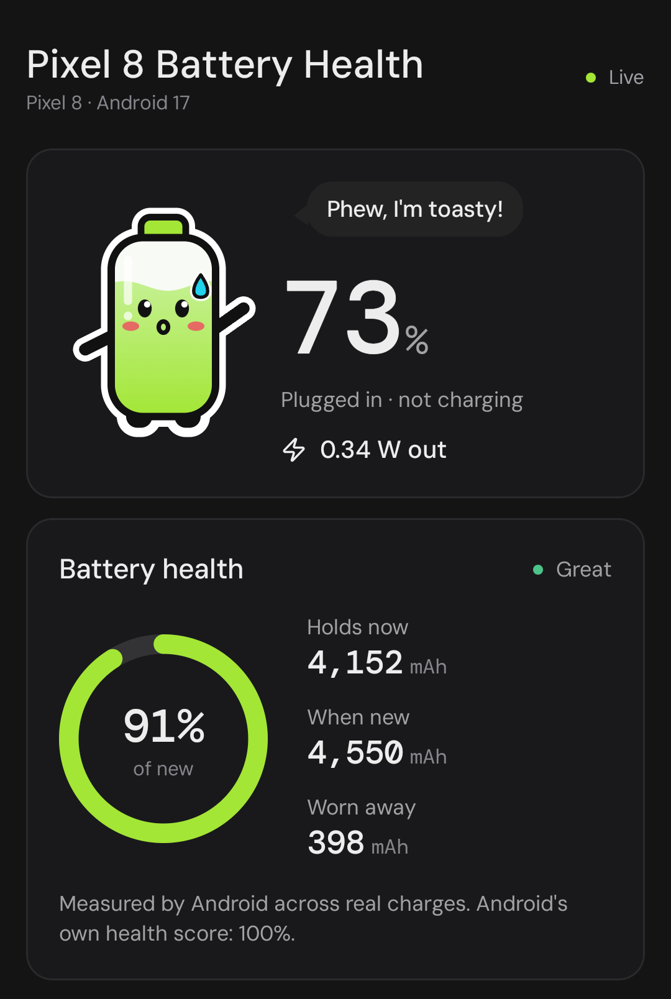

# Pixel 8 Battery Health

[](https://github.com/AhmedVohra/Pixel-8-Battery-Health/releases/latest)
[](https://github.com/AhmedVohra/Pixel-8-Battery-Health/releases)


Free Android app to check your **Pixel 8 battery health**: how much charge the battery holds now compared with when it was new, the **charge cycle count**, live power use, and **what is draining your battery** since the last charge. No root needed.

**[Download the APK](https://github.com/AhmedVohra/Pixel-8-Battery-Health/releases/download/v1.1/Pixel-8-Battery-Health-1.1.apk)** · [Website](https://ahmedvohra.github.io/Pixel-8-Battery-Health/) · [All releases](https://github.com/AhmedVohra/Pixel-8-Battery-Health/releases)



## What it shows

- **Battery health**: capacity now vs. the 4,550 mAh design capacity, as a percentage and in mAh, plus how much has worn away
- **Charge cycle count** and average cycles per day
- **Live power** in watts, averaged over 30 seconds, with the current reading, the peak and a graph of the last two minutes
- **What is draining the battery**: time on battery since the last charge, mAh used with the screen on and off, how much went to mobile data, CPU, screen and GPU, and the top 5 apps with how much each used while not on screen
- **Temperature, voltage and current** (charge or drain in mA)
- **Battery age**: manufacture date, first-use date and time in use
- **Charging**: status, charger type and time until full

## How to check battery health on a Pixel 8

1. On your phone, download [Pixel-8-Battery-Health-1.1.apk](https://github.com/AhmedVohra/Pixel-8-Battery-Health/releases/download/v1.1/Pixel-8-Battery-Health-1.1.apk) (3.5 MB).
2. Open it and allow your browser or file manager to install apps when Android asks.
3. Open **Pixel 8 Battery Health**. Charge cycles, temperature and live power show right away, and the Battery health card shows an estimate.

Needs Android 8.0 or newer. Built and tested on a Pixel 8 with Android 17. The cycle count needs Android 14 or newer.

## How to see what is draining your Pixel 8 battery

1. Grant the permissions below once from a computer.
2. Open the app and scroll to **Since last charge**. It lists what used the battery since you last charged: mobile data, CPU, screen and GPU, and the top 5 apps.
3. Under each app, "while not on screen" shows how much of its use happened in the background.

The numbers are Android's own estimate and refresh each time you open the app.

## Unlock measured capacity and battery use (optional)

Android's measured capacity, its health score, the battery dates and the per-app battery use sit behind system permissions that only a computer can grant. Turn on USB debugging, connect the phone and run:

```
adb shell pm grant dev.rubiks.batterybuddy android.permission.BATTERY_STATS
adb shell pm grant dev.rubiks.batterybuddy android.permission.DUMP
adb shell pm grant dev.rubiks.batterybuddy android.permission.PACKAGE_USAGE_STATS
```

| Permission | Unlocks |
|---|---|
| `DUMP` and `PACKAGE_USAGE_STATS` | Battery capacity measured by Android across real charges, and the Since last charge card |
| `BATTERY_STATS` | Android's health score, manufacture date and first-use date |

Without them the app estimates health from the current charge. The grants stay through app updates.

## FAQ

**Does it need root?** No.

**Why does the power reading jump when I open an app?** Opening or switching apps spikes power for a few seconds, and a single one-second reading can look like heavy drain. The app shows a 30-second average as the main number, leaves out the spike from opening the app itself, and shows the current reading and the peak next to it.

**Why is the reading low while the phone is plugged in?** When the phone is plugged in but not charging, the charger supplies part of the power, so the app only sees what the battery adds. It says so on screen. Unplug for a reading of the phone's total use.

**Does it work on the Pixel 8 Pro, 8a or other phones?** It installs on any phone with Android 8.0 or newer and shows live readings. The design capacity is built in for the Pixel 8 only; other phones have not been tested.

**Is my battery data sent anywhere?** No. Battery readings and per-app battery use stay on the phone. The app shows one Google AdMob banner ad. See the [privacy policy](https://ahmedvohra.github.io/Pixel-8-Battery-Health/privacy.html).

**Is the source code available?** No, only the APK is published.

## Verify the download

- APK SHA-256: `237b9a90a66a81dc7405ec61aec82a7f056c21381eb561f192f338bfa2e53c71`
- Signing certificate SHA-256: `f02d11df8b793a903a44286f3a3ede52c155cd09756d3c8578a22aac2df846ee`

---

Not affiliated with Google. Pixel is a trademark of Google LLC.
